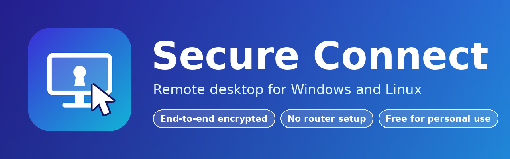

<p align="center"></p>

# Secure Connect

Secure Connect lets you see and control another computer's screen over the
internet, or let someone see and control yours, with the connection
encrypted from one computer to the other. It runs on Linux and Windows, has
no installer, and needs no router configuration.

> **Status: version 0.2.2, early release.**
> Tested on real computers so far: a Windows PC connecting to and controlling
> a Linux (Ubuntu, GNOME on Wayland) PC. Not yet tested on real computers: a
> Windows PC as the computer being controlled, and the clipboard, file
> transfer, keyboard layout conversion and saved-computer features (they have
> only been tested with automated tests). Both computers must run the same version (the
> connection protocol changed; older versions are refused with a clear message).
> Please try it on computers that do not matter before relying on it. See
> [What has been tested](#what-has-been-tested).

This repository contains the compiled programs, documentation, licence and
checksums. The source code is not
published.

## Download

Download the program for your computer straight from this page (click the
file, then the download button), or from the [Releases](../../releases/latest)
page:

| Your computer | File to download |
| --- | --- |
| Linux, 64-bit (Ubuntu 24.04 or newer) | [`secure-connect-linux-x86_64`](secure-connect-linux-x86_64) |
| Windows 10 / 11, 64-bit | [`secure-connect-windows-x86_64.exe`](secure-connect-windows-x86_64.exe) |

Then [verify your download](#verify-your-download) (recommended).

## Quick start

1. **Start it on both computers.**
   - Linux: `chmod +x secure-connect-linux-x86_64`, then
     `./secure-connect-linux-x86_64` (or allow executing it in your file
     manager and double-click it).
   - Windows: double-click `secure-connect-windows-x86_64.exe`. Windows
     SmartScreen may warn about an unrecognised app because it is not
     signed; choose "More info", then "Run anyway" if you trust the source.
2. **On the computer to be controlled (the host):** decide who may get in:
   tick **Ask me to accept each connection** (someone is there to press
   Accept), and/or set an **Unattended password** (a long one, different
   for every computer). Then press **Copy** next to **Your ID** and send the
   ID to the other person.
3. **On the other computer (the viewer):** paste the ID under **Connect to
   another computer**, type the password if there is one, and press
   **Connect**. The host's screen opens in a new window.
4. **To finish:** close the remote window, or press **End** / **End all** on
   the host.

On Linux with GNOME on Wayland (the Ubuntu default), the system itself asks
for approval of screen sharing and remote control **once**, in its own dialog
on the host computer. Secure Connect cannot skip or answer that dialog, not
even for a correct password: it is the operating system's protection. Do it
once while you are at that computer; it is remembered, and after that anyone
with the password connects with nobody having to approve anything.

Full instructions: [USER-GUIDE.md](USER-GUIDE.md).

## Running it in the background on Linux

Secure Connect is a window app: it needs your logged-in desktop and cannot
run without a screen. Closing its window quits it (there is no tray icon
yet), so to keep it running, minimise the window.

**Start it detached from the terminal** (closing the terminal will not stop
it):

```sh
setsid nohup ./secure-connect-linux-x86_64 >/dev/null 2>&1 &
```

**Start it automatically when you log in:**

```sh
mkdir -p ~/.config/autostart
cat > ~/.config/autostart/secure-connect.desktop <<'EOF'
[Desktop Entry]
Type=Application
Name=Secure Connect
Exec=/full/path/to/secure-connect-linux-x86_64
X-GNOME-Autostart-enabled=true
EOF
```

Replace `/full/path/to/` with where you saved the program, and keep it
there (update `Exec=` if you move it). Log out and in again to check.

**Check or stop it:**

```sh
pgrep -a secure-connect
pkill secure-connect
```

Limits:

- After a reboot nobody can connect until you have logged in. Automatic
  login in your desktop settings avoids that, but lets anyone at the
  keyboard in.
- While the screen is locked, the remote picture and control do not work.
- On GNOME Wayland the screen-sharing approval should be remembered after
  the first time; if it asks again after a reboot, approve it again.

## Platform support

| | Linux (X11) | Linux (GNOME on Wayland) | Windows 10 / 11 |
| --- | --- | --- | --- |
| Use as viewer | Yes | Yes | Yes (tested) |
| Share the screen (host) | Whole screen | Yes, after a one-time approval | Main monitor only (untested) |
| Remote mouse and keyboard | Yes (tested only with simulated input) | Yes, through the desktop's remote-control portal (approval asked once; not yet verified on every setup) | Yes, except lock screen, UAC prompts and admin programs (untested) |

Linux needs glibc 2.38 or newer (Ubuntu 24.04+, Debian 13+, Fedora 39+) and
the PipeWire and xkbcommon libraries that a standard desktop already has.
**Ubuntu 22.04 and older are not supported.** Only 64-bit x86 PCs are
supported; there is no macOS, ARM or mobile version.

## Features

**Available now**

- End-to-end encrypted connections (QUIC / TLS 1.3), with a hybrid
  post-quantum key exchange (X25519 + ML-KEM-768) used by default, and an
  optional setting to refuse any connection without it.
- Works through home and office routers without port forwarding: direct
  connections when possible, otherwise through a public relay.
- A permanent ID per computer; no account or sign-up.
- Two ways to allow access: a password (unattended; the correct password lets
  someone in with no prompt) or an Accept/Deny prompt (attended, used when no
  password is set).
- Protection against password guessing, with lockouts and a failed-attempt
  counter.
- Up to 5 viewers at once; the first one controls, the others watch.
- Shows who is connected, with End and End all buttons; security settings are
  locked while anyone is connected.
- Video at up to 30 frames per second (H.264, about 3 Mbit/s).

- **Keyboard layouts:** each side keeps its own layout. What you type is sent
  as the character, and the other computer types it on its own layout
  (German to US and so on). A setting switches to matching physical key
  positions instead. Dead keys and input-method editors (Chinese, Japanese,
  Korean) are not supported yet.
- **Remember password:** a box on the Connect row keeps the password in the
  system secret store (Windows Credential Manager, Linux Secret Service).
- **New in 0.2:** shared text clipboard in both directions; a file manager
  to browse the other computer and copy files and folders both ways (with
  resume, progress, rename, delete and pinned folder shortcuts); saved
  computers as one-click cards with optional thumbnails and an optional
  remembered password kept in the system's secret store; Copy / Paste
  buttons for IDs. Clipboard and file access are on by default and can be
  switched off by the host. **Anyone you let in with file access on can
  read and write files as you; see SECURITY.md.**

**Not available (yet)**

- Sound; image and file clipboard.
- Separate desktops for several users on one Linux computer.
- Choosing your own relay server in the app.
- Hardware video encoding; automatic quality adjustment for slow
  connections.
- A log of who connected and when.
- A message telling extra viewers that they can only watch.
- Forwarding of the Windows key, Alt+Tab, Ctrl+Alt+Del and held-down key
  repeat; dead keys and input-method editors.
- On a slow connection the picture can run behind (a known limit; keystrokes
  themselves are not delayed).

## Security summary

- Picture, mouse, keyboard and the password check are encrypted between the
  two computers; the relay servers cannot read them.
- The ID is a public key: it proves which computer you reached, but anyone
  who knows it can see when that computer is online and try to connect.
- The password is never stored or sent; a check value (Argon2id) is stored in
  a file only your account can read. Anyone who can read that file can log
  in, so keep it private.
- Use a **different, long password for every computer**.
- Someone who knows your ID can keep password logins locked by guessing on
  purpose (Accept prompts still work).
- The computer IDs use classical (Ed25519) keys, not post-quantum ones.
- By default the public relay and lookup servers of number 0 (the makers of
  the iroh networking library) are used. They can see which IDs connect and
  when, but not the content. They are rate-limited and not meant for heavy
  use.
- The networking library may ask your router to open a port automatically
  (UPnP / NAT-PMP).
- No independent security review has been done.

Details: [SECURITY.md](SECURITY.md).

## Known limitations

- **Windows:** viewing and controlling a Linux PC from Windows has been
  tested. A Windows PC as the computer being controlled has not. As a
  host it cannot see or control the lock screen, UAC prompts or programs
  running as administrator, and only shows the main monitor.
- **Linux Wayland:** the system's screen-sharing and remote-control dialog
  must be approved once at the host computer (a password cannot replace it);
  after that it is remembered.
- Only the first viewer can control; extra viewers' input is silently
  ignored.
- Keyboard layout conversion has only been tested with simulated keyboards,
  not yet on real mixed-layout machines; some special keys are not forwarded.
- HiDPI screens and multiple monitors have not been tested.
- The public relays are rate-limited and may be slow.

## What has been tested

- **Checked:** automated tests of the connection, encryption, password
  checks, lockouts, Accept prompts and video with simulated screens and
  input; Wayland screen sharing on a real GNOME desktop (30 frames per
  second, approval remembered).
- **Not yet checked:** two computers over the real internet; the
  post-quantum key exchange through the public relays; real mouse and
  keyboard control on every setup; a Windows PC as the computer being
  controlled; HiDPI and multi-monitor setups.

Bug reports are welcome. Never include passwords or the files in the
Secure Connect settings folder in a report.

## Verify your download

The file [SHA256SUMS](SHA256SUMS) in this repository lists the SHA-256
checksum of each program. Download it next to the program. If the checksum
of your file matches, the file is exactly the one published.

**Linux** (in the folder with the download and `SHA256SUMS`):

```sh
sha256sum -c SHA256SUMS --ignore-missing
```

It should print `secure-connect-linux-x86_64: OK`.

**Windows** (PowerShell, in the download folder):

```powershell
Get-FileHash .\secure-connect-windows-x86_64.exe -Algorithm SHA256
```

Compare the `Hash` shown with the line for
`secure-connect-windows-x86_64.exe` in `SHA256SUMS` (upper/lower case does
not matter).

A checksum only proves the file matches this page. The programs are not
code-signed.

## Licence

Secure Connect is licensed under the **PolyForm Noncommercial License
1.0.0** (see [LICENSE](LICENSE)). This is not an open-source licence: it is **free for personal use, study, research, education
and non-profit use**. **Commercial and enterprise use needs a paid
licence from the owner, Tuan Aqeel Bohoran: contact
aqeelbohoran@gmail.com.** The programs are provided as compiled programs
only, "as is", without any warranty.

The programs include open-source components that remain under their own
licences (MIT, Apache-2.0, BSD, MPL-2.0, font licences and others), listed
with their full texts in [THIRD-PARTY-LICENSES.txt](THIRD-PARTY-LICENSES.txt).
Nothing in the LICENSE limits your rights under those licences.

**H.264 patents:** video uses OpenH264, compiled into the programs from
source. Cisco's H.264 patent coverage applies only to Cisco's own OpenH264
binaries, not to these programs. Users are responsible for any H.264 patent
licensing that may apply in their country.

*This is not legal advice; the owner should have the licence reviewed by a
lawyer.*
